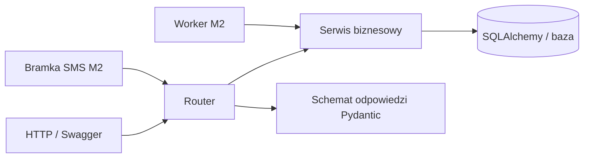

# Architektura API

## Pierwsza wersja

Python 3.13, FastAPI, Pydantic 2, synchroniczny SQLAlchemy 2.x i Alembic. Lokalnie SQLite, testy przez pytest i FastAPI TestClient/HTTPX. Przed rzeczywistym równoległym przetwarzaniem SMS w M2 przechodzimy na PostgreSQL i uruchamiamy na nim testy integracyjne. Nie używamy SQLModel, żeby ćwiczyć SQLAlchemy bez dodatkowej warstwy.

Wersje bibliotek ustal w T01 po instalacji i zapisz w pliku zależności. Nie kopiuj przykładów używających Pydantic 1 albo dawnego `session.query()` jako podstawowego stylu zapytań. Używaj `Mapped`, `mapped_column`, `select` i `Session` zgodnie z [SQLAlchemy](https://docs.sqlalchemy.org/en/21/orm/quickstart.html).

Przy synchronicznej sesji zwykłe operacje HTTP mogą być funkcjami `def`. Async, własny framework repozytoriów i kolejka z osobnym brokerem nie są potrzebne do M0.

## Odpowiedzialności



- **Model ORM:** trwałe dane i ograniczenia bazy.
- **Schema Pydantic:** kontrakt wejścia i wyjścia, formaty i walidacja pojedynczych danych.
- **Router:** HTTP, zależności, kod odpowiedzi, wywołanie serwisu.
- **Serwis:** reguły obejmujące klienta, ofertę, termin i transakcję.
- **Parser:** czysta funkcja treść + słownik + oferta -> propozycja; bez samodzielnego zapisu zamówienia.
- **Adapter SMS:** mapuje format dostawcy na własny model wiadomości; nie ustala zasad zamawiania.

Pierwszy prosty odczyt można napisać w routerze. Serwisy wydzielamy, kiedy pojawia się logika zamówienia. Nie twórz pustych klas i repozytoriów na zapas.

## Docelowa struktura po M0

Na etapie T02 pracujemy w istniejącym `src/Backend/main.py`. Poniższy katalog `app/` jest strukturą docelową; bieżące importy i komendy uruchamiania dopasowujemy do rzeczywistego położenia pliku. Nie przenosimy plików przed pierwszym endpointem.

```text
app/
  main.py
  config.py
  database.py
  dependencies.py
  errors.py
  models/
    base.py
    customer.py
    product.py
    bake.py
    order.py
  schemas/
    common.py
    customer.py
    product.py
    bake.py
    order.py
    summary.py
  routers/
    health.py
    customers.py
    products.py
    bakes.py
    orders.py
  services/
    orders.py
    bakes.py
    summaries.py
  utils/
    phone.py
    clock.py
alembic/
tests/
  conftest.py
  unit/
  integration/
  api/
```

W M1 dochodzą pliki `groups`, `aliases`, `messages`, `settings` w odpowiednich katalogach i `parsing/`. W M2 dochodzą `campaigns`, `reports`, `webhooks`, `integrations/sms/` i `worker/`. Struktura jest planem, a nie listą plików do utworzenia na pierwszej lekcji.

## Sesje i transakcje

Jedna sesja na żądanie lub pojedyncze zadanie workera. Sesja jest zamykana po operacji. Nie współdzielimy jej między wątkami i zadaniami. Zasady opisuje [SQLAlchemy Session](https://docs.sqlalchemy.org/en/20/orm/session_basics.html).

Serwis mutujący odpowiada za jedną granicę transakcji: albo całe zamówienie wraz z pozycjami zostaje zapisane, albo nie zapisuje się nic. Nie rób `commit()` po każdej pozycji. Po `IntegrityError` wykonaj rollback przed dalszym użyciem sesji. Ograniczenia unikalności bazy są ostateczną ochroną przed wyścigiem dwóch żądań.

SQLite musi mieć włączone `PRAGMA foreign_keys=ON` dla każdego połączenia, także w testach. Do testów najprościej użyć osobnego pliku w `tmp_path`, unikając problemów osobnych baz `:memory:` na różnych połączeniach. Migracje tworzą schemat aplikacji; `create_all()` nie zastępuje Alembic.

## Czas

API przyjmuje daty ISO 8601 z jawną strefą, np. `2030-11-22T18:00:00+01:00`. Daty bez strefy są błędem 422. Przechowywanie i porównania odbywają się w UTC, wyświetlanie w `Europe/Warsaw`. `bake_date` jest lokalną datą kalendarzową, nie chwilą UTC.

SQLite nie zapewnia sam z siebie całej oczekiwanej semantyki stref. W zadaniu T04 wybierz spójną reprezentację UTC i dopilnuj przywracania informacji o strefie przy odczycie. Po zmianie bazy powtórz testy czasu. Czas pobieraj z wstrzykiwanej funkcji/zależności, żeby w testach nie używać `sleep()`.

## Dostęp i konfiguracja

Do końca M0 endpointy biznesowe wymagają nagłówka `X-API-Key`. Klucz pracownika jest konfiguracją środowiska, nie polem modelu klienta. `/health` jest publiczny i nie ujawnia konfiguracji. Porównuj sekrety przez `secrets.compare_digest`; brak i zły klucz zwracają 401. Używaj HTTPS przy udostępnieniu poza komputerem.

Na początkowych lekcjach API działa tylko lokalnie. To nie oznacza gotowości do publicznego wdrożenia. W M2 webhook ma własne uwierzytelnianie zgodne z dostawcą, oddzielne od klucza pracownika. Nie wystawiamy symulatora SMS w środowisku produkcyjnym.

Planowane zmienne: `APP_ENV`, `DATABASE_URL`, `API_KEY`, `TIMEZONE`; od M2 również dane adaptera SMS i ustawienia workera. `.env` trafia do `.gitignore`, `.env.example` ma wyłącznie nazwy i niesekretne przykłady. Logi nie zawierają kluczy, pełnych nagłówków autoryzacji ani pełnych numerów telefonów i treści zamówień bez potrzeby diagnostycznej.

## Zasady HTTP

Prefiks `/api/v1`, JSON UTF-8, `snake_case`, dodatnie identyfikatory całkowite. Listy: `limit` domyślnie 50, zakres 1-100, `offset` domyślnie 0, minimum 0. Odpowiedź ma `items`, `total`, `limit`, `offset`. `total` dotyczy tego samego filtra przed stronicowaniem. Sortowanie domyślne po `id` rosnąco.

Każdy schema wejściowy odrzuca nieznane pola. PATCH zmienia tylko przekazane pola: pominięcie zachowuje starą wartość, `null` czyści jedynie pole dopuszczające null. Pusty PATCH to 422. PUT zamówienia zastępuje obie listy pozycji i notatkę; nie jest częściowym PATCH.

Jednolity błąd:

```json
{"error":{"code":"CUSTOMER_NOT_FOUND","message":"Nie znaleziono klienta.","details":[]}}
```

Element `details`: `{"field":"phone","message":"Niepoprawny format."}`. 401 oznacza brak dostępu, 404 brak wskazanego zasobu, 409 konflikt z aktualnym stanem, 422 niepoprawny format lub wartości wejściowe. Błędy walidacji i niepoprawny JSON także mapujemy na ten format. Nie ujawniamy SQL ani tracebacka.

## M2: wiadomości i zadania

Webhook najpierw uwierzytelnia żądanie i trwale zapisuje wiadomość oraz zadanie, następnie potwierdza odbiór. Parser i aplikowanie nie muszą zakończyć się podczas tego żądania. Deduplikacja opiera się na identyfikatorze dostawcy, nie na treści SMS.

Worker pobiera trwałe zadania z bazy. Potrzebne są próby, termin ponowienia, blokada pobranego zadania, odzyskanie po restarcie i widoczny błąd końcowy. Równoległe workery testujemy na PostgreSQL. Dostawca może przyjąć wysyłkę, mimo że aplikacja nie otrzyma odpowiedzi: taki przypadek ma stan `unknown`, a nie ślepe ponowienie. Jeżeli dostawca oferuje klucz idempotencji lub odczyt stanu, adapter z niego korzysta. Nie obiecujemy transportu „dokładnie raz”.

Nie wybieramy jeszcze dostawcy ani generatora PDF. Wybór następuje w zadaniach T27 i T30 na podstawie sprawdzonej dokumentacji i środowiska uruchomienia.

Jeśli potwierdzenia zamówień są włączone, zadanie potwierdzenia zapisuj w tej samej transakcji co rzeczywista zmiana zamówienia. Klucz np. `order-confirmation:{order_id}:{version}` chroni przed ponownym zaplanowaniem. Bezskutkowe ponowienie confirm/apply nie wysyła kolejnego potwierdzenia. Treść zawiera datę pieczenia i przyjęte pozycje; samo odebranie lub sparsowanie SMS-a nie uruchamia potwierdzenia przyjęcia.

## Późniejszy frontend

Django obsłuży sesje pracowników i HTML. Dane biznesowe pozostaną w FastAPI, dostępne przez wywołania serwer-serwer. Django nie tworzy własnych tabel klientów, produktów i zamówień. Zmiana uwierzytelniania na konta pracowników jest osobnym etapem po API.
