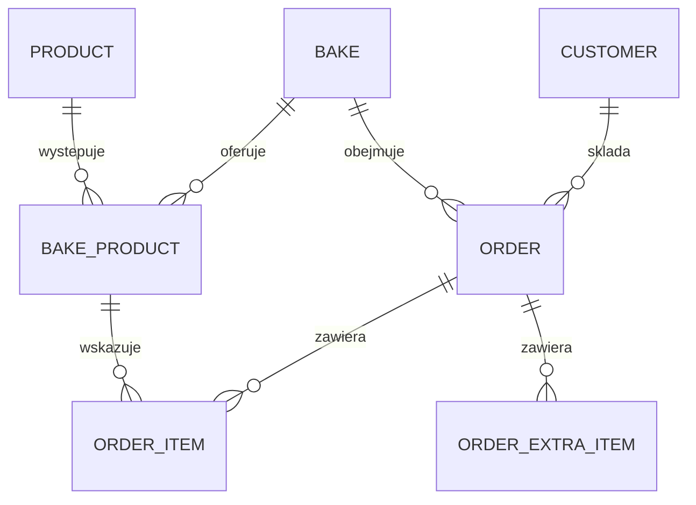

# Modele SQLAlchemy

To projekt klas ORM, nie gotowe klasy do przeklejenia. Nazwy klas są w PascalCase, tabel i kolumn w snake_case. Każdy FK ma indeks. `created_at` i `updated_at` są chwilami UTC ustawianymi przez serwer. ID to `Integer` PK. Nie używamy kasowania kaskadowego klienta, produktu ani pieczenia z historią.

## Relacje M0

## Customer / customers, M0

| Pole | Typ bazy | Null / domyślnie | Reguła |
|---|---|---|---|
| id | Integer | PK | |
| display_name | String(160) | nie | Niepuste po trim |
| phone | String(16) | nie | Kanoniczne `+` i 8-15 cyfr, UNIQUE |
| address | String(500) | tak | Tekst do odbioru/dostawy; bez osobnego modelu adresowego |
| notes | Text | tak | Maks. 2000 znaków w API |
| allow_extra_items | Boolean | false | Uprawnienie do nowych lub zwiększonych dodatków |
| is_active | Boolean | true | Archiwizacja |
| created_at, updated_at | UTC datetime | nie | |

Normalizacja telefonu: usuń spacje, nawiasy i myślniki; 9 polskich cyfr poprzedź `+48`; `00` na początku zamień na `+`; inne formaty bez prefiksu odrzuć. To sprawdzenie formatu, nie dowód istnienia numeru. Znormalizowany numer jest porównywany także z klientami nieaktywnymi.

## Product / products, M0

| Pole | Typ bazy | Null / domyślnie | Reguła |
|---|---|---|---|
| id | Integer | PK | |
| name | String(160) | nie | Nazwa do wyświetlania |
| normalized_name | String(160) | nie | UNIQUE; ta sama normalizacja co aliasy |
| description | Text | tak | Maks. 2000 znaków |
| unit | String(16) | piece | W M0 tylko `piece`, bez późniejszej zmiany |
| is_active | Boolean | true | Archiwizacja |
| created_at, updated_at | UTC datetime | nie | |

Nazwy są unikalne po normalizacji. Zachowaj nazwę oryginalną. W M1 nazwa główna ma również kanoniczny wpis w tabeli aliasów; tworzenie i zmiana nazwy aktualizują oba rekordy w jednej transakcji.

## Bake / bakes, M0

| Pole | Typ bazy | Null / domyślnie | Reguła |
|---|---|---|---|
| id | Integer | PK | |
| code | właściwość odczytu | nie | Wyliczana jako `P{id}`; nie jest osobną kolumną |
| name | String(160) | nie | |
| bake_date | Date | nie | UNIQUE dla jednej piekarni |
| accepting_from | UTC datetime | nie | Początek przyjmowania |
| order_deadline | UTC datetime | nie | `accepting_from < order_deadline` |
| status | String(16) | draft | CHECK: draft/open/closed |
| opened_at, closed_at | UTC datetime | tak | Ślad jawnych operacji |
| created_at, updated_at | UTC datetime | nie | |

Data końca zapisów w strefie Warszawy nie może być późniejsza niż `bake_date`. `code` wylicza właściwość modelu lub mapper odpowiedzi po uzyskaniu ID; nie jest wejściem API. Unikalność wynika z ID. Nie zapisuj pustego kodu przed flush ani nie twórz drugiego commitu dla kodu. Nie ma endpointu usuwania pieczenia, więc jego ID i kod nie są ponownie używane.

Przejścia: `draft -> open -> closed`. Brak cofania do draft. Ponowne `open` dla open i `close` dla closed zwraca ten sam rekord bez zmiany pierwszego czasu operacji. Otwarcie closed i zamknięcie draft to 409. Wygaśnięcie okna może poprzedzać zmianę statusu na closed; walidacja zawsze sprawdza czas.

## BakeProduct / bake_products, M0

| Pole | Typ bazy | Reguła |
|---|---|---|
| id | Integer PK | Identyfikator pozycji oferty, używany w zamówieniu |
| bake_id | FK bakes.id | RESTRICT przy usuwaniu pieczenia |
| product_id | FK products.id | RESTRICT |
| product_name_snapshot | String(160) | Kopia nazwy w chwili dodania do oferty |
| unit | String(16) | `piece`, kopia jednostki |
| created_at | UTC datetime | |

UNIQUE(bake_id, product_id). Dodawanie i usuwanie tylko w draft. Otwarcie ponownie sprawdza aktywność produktów. Późniejsza archiwizacja produktu nie usuwa już ogłoszonej oferty. Zmiana produktu katalogowego nie zmienia snapshotu.

## Order / orders, M0

| Pole | Typ bazy | Null / domyślnie | Reguła |
|---|---|---|---|
| id | Integer | PK | |
| customer_id | FK customers.id | nie | RESTRICT |
| bake_id | FK bakes.id | nie | RESTRICT |
| customer_name_snapshot | String(160) | nie | Nazwa przy utworzeniu |
| customer_phone_snapshot | String(16) | nie | Numer przy utworzeniu |
| status | String(16) | draft | CHECK: draft/confirmed/cancelled |
| source | String(16) | manual | M1 dodaje sms; nie ustawia tego zwykły klient API |
| submitted_at | UTC datetime | nie | W M0 czas utworzenia przez serwer |
| notes | Text | tak | Maks. 2000 znaków |
| confirmed_at, cancelled_at | UTC datetime | tak | Ostatnie właściwe przejście |
| created_at, updated_at | UTC datetime | nie | |

UNIQUE(customer_id, bake_id). Przejścia: draft -> confirmed, draft/confirmed -> cancelled, cancelled -> draft przez reopen. Confirm i cancel powtórzone na docelowym statusie są bezskutkowe i zwracają 200. Reopen dla draft też jest bezskutkowe; dla confirmed daje 409. Po ponownym otwarciu ustaw `cancelled_at=null`, po anulowaniu `confirmed_at=null`.

Pozycje pozostają po anulowaniu, lecz nie są liczone. Poterminowe dokończenie poprawnie zgłoszonego szkicu jest możliwe; utworzenie nowego ręcznego zamówienia po terminie nie jest możliwe w M0. Podczas reopen wymagane są otwarte zapisy i aktywny klient.

## OrderItem / order_items, M0

`id` PK, `order_id` FK orders.id, `bake_product_id` FK bake_products.id, `quantity` Integer CHECK > 0. UNIQUE(order_id, bake_product_id). Powiązanie pozycji z tym samym pieczeniem co zamówienie sprawdza serwis. Ewentualny złożony FK można dodać później; test tej reguły jest obowiązkowy od początku.

Pozycje należą do zamówienia; przy zastępowaniu listy mogą być usuwane wewnątrz transakcji. Oferta nie może być usunięta, gdy wskazuje ją pozycja zamówienia.

## OrderExtraItem / order_extra_items, M0

`id` PK, `order_id` FK orders.id, `description` String(160), `quantity` Numeric(12,3), `unit` String(16), `original_text` Text nullable, `created_at` UTC datetime. CHECK quantity > 0, CHECK unit IN ('piece','kg','g'). Wymóg całkowitej ilości `piece` waliduje schema/serwis.

W API Decimal jest tekstem, np. `"10.000"`, nigdy floatem. Maksimum to 999999999.999. Oryginalny fragment tekstu pochodzi z parsera w M1, nie jest wymagany przy ręcznym zamówieniu. Równe opisy dodatków nie muszą się scalać.

## Rozszerzenia M1

| Model | Pola i ograniczenia |
|---|---|
| CustomerGroup | id, name String(100), normalized_name UNIQUE, created_at, updated_at |
| CustomerGroupMember | group_id FK, customer_id FK; wspólny PK, bez duplikatów |
| ProductAlias | id, product_id FK, text String(160), normalized_text UNIQUE, is_canonical Boolean, created_at; kanonicznego aliasu nie usuwa zwykły DELETE |
| AppSettings | singleton id=1, default_bake_id nullable FK, default_set_at nullable UTC datetime; brak automatycznej zmiany terminu |
| SmsMessage | pola opisane niżej; w M1 dostawca `simulation` |
| MessageInterpretation | id, message_id FK, parser_version, payload JSON, created_at; kolejne parsowanie dodaje wersję |

AppSettings zastępuje wiele flag `is_default` w tabeli pieczeń. Jedna kolumna wskazująca FK gwarantuje najwyżej jeden domyślny rekord. Ustawienie wymaga pieczenia open z nieprzekroczonym końcem zapisów; może dotyczyć terminu, którego okno dopiero się zacznie. To nie powoduje wysyłki SMS.

SmsMessage: id; direction incoming/outgoing; provider String(40); provider_message_id nullable String(160); from_phone; to_phone; body Text; customer_id nullable FK; bake_id nullable FK; received_at nullable UTC; sent_at nullable UTC; routing_status unassigned/assigned; review_status pending/applied/ignored; delivery_status nullable queued/submitted/delivered/failed/unknown; applied_order_id nullable FK; applied_at nullable UTC; ignore_reason nullable Text; created_at; updated_at. UNIQUE(provider, provider_message_id) przy nie-null identyfikatorze. Treść i identyfikacja transportowa są niezmienne. Numery przychodzące, których nie da się poprawnie znormalizować, zachowujemy w metadanych odbioru i kierujemy do wyjaśnienia, bez tworzenia klienta.

`MessageInterpretation.payload` zawiera dopasowane produkty, kandydatów na dodatki, problemy i wskazanie trybu new/review_existing. Nie są to przyjęte OrderItem. Wiadomość ma najwyżej jedno zastosowanie, nawet po ponownym parsowaniu.

M1 dodaje `version` Integer default 1 do Order. Każda zmiana zamówienia zwiększa go przez warunkową aktualizację lub blokadę. Przegląd kolejnego SMS-a wymaga oczekiwanej wersji zamówienia; nie może nadpisać pracy drugiego operatora.

## Rozszerzenia M2

| Model | Pola i ograniczenia |
|---|---|
| Bake, nowe pola | notify_enabled Boolean default false, data_version Integer default 1 |
| Customer, nowe pole | sms_enabled Boolean default false; możliwość wyłączenia ogłoszeń bez usuwania klienta |
| SmsCampaign | id, bake_id FK, audience all/groups, group_ids_snapshot JSON, text_snapshot Text, status queued/running/completed/completed_with_errors, created_at |
| CampaignRecipient | id, campaign_id FK, customer_id FK, phone_snapshot, sms_message_id nullable FK, status queued/submitted/delivered/failed/unknown; UNIQUE(campaign_id, customer_id) |
| Job | id, kind, payload JSON, deduplication_key UNIQUE, status queued/running/done/failed/unknown, attempts, next_attempt_at, locked_at nullable, locked_by nullable, last_error nullable, created_at, updated_at |
| OrderAmendment | id, order_id FK, reason Text, before_payload JSON, after_payload JSON, created_at; zmiana i zapis audytu są jedną transakcją |
| BakeReport | id, bake_id FK, revision Integer, data_version Integer, state draft/final, snapshot JSON, storage_key, created_at, finalized_at nullable; UNIQUE(bake_id, revision) |
| IdempotencyRecord | id, scope String(100), key String(160), request_hash String(64), result JSON, created_at; UNIQUE(scope,key); trwały wynik kampanii lub korekty |

Aktualizacja zamówienia, zmiana statusu i pojawienie się istotnej nowej sprawy wiadomości zwiększają `Bake.data_version` w tej samej transakcji. Obejmuje to również zapis późno dostarczonego SMS-a przypisanego do już raportowanego pieczenia. Finalizacja raportu porównuje wersję pod blokadą. Stary PDF pozostaje niezmieniony i może być oznaczony jako nieaktualny.

## Indeksy i migracje

Od M0: unikalny telefon, znormalizowana nazwa produktu, data pieczenia, para klient-pieczenie, para pieczenie-produkt, para zamówienie-pozycja oferty. Kod pieczenia wynika z klucza głównego. Dodatkowo indeksy orders(bake_id,status), bakes(status,order_deadline).

Od M1: unikalne aliasy, indeks wiadomości po bake_id/review_status i received_at. Migracja tworzy kanoniczne aliasy istniejących nazw; konflikt zatrzymuje migrację z opisem danych wymagających poprawy. Nie usuwaj bazy, żeby „naprawić migrację”.

Od M2: indeks jobs(status,next_attempt_at), kampanie według bake_id, raporty według bake_id/revision. Na PostgreSQL testuj konkurencyjną zmianę wersji i wybieranie zadań. Sam SQLite nie potwierdza poprawności blokad PostgreSQL.
